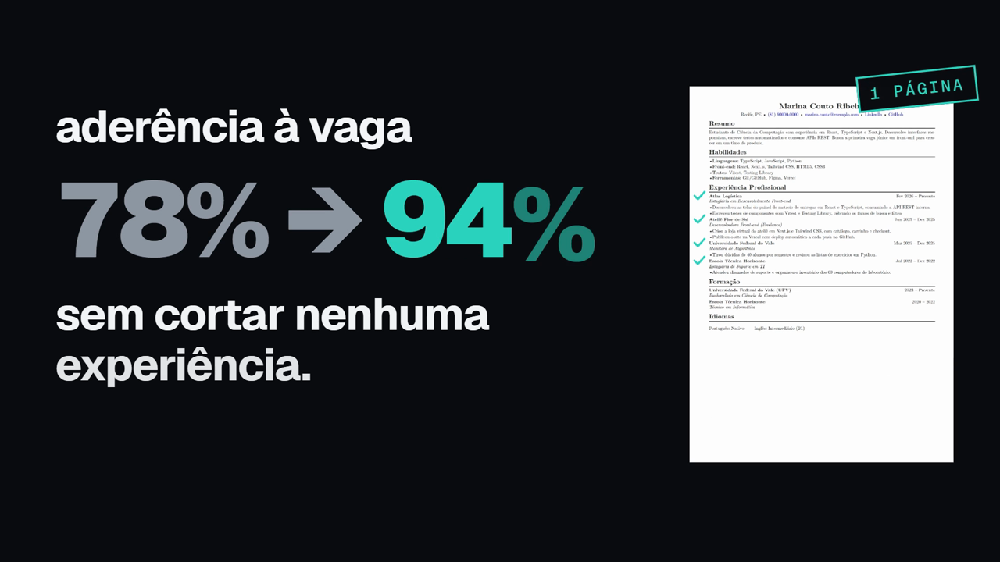

# cv-adapter

Tailors your resume to one specific job posting with AI, using only what is already in your resume.
It runs on your own machine with Docker, and you bring your own DeepSeek API key.

[](docs/media/showreel.mp4)

The interface is in Brazilian Portuguese. The demo uses a made-up person and job.

## How it works

1. **Import your resume.** Upload a PDF. Your name and contact details are split off before
   anything is sent to the AI, and the rest becomes your career profile: each experience with the
   evidence lines behind it. You review and correct it before it is saved.
2. **Paste a job posting.** It is broken down into requirements, required and nice to have.
3. **See the match.** Each requirement is marked covered, partial or missing against your profile,
   with a match score.
4. **Get a tailored resume.** Every experience you have stays in. What changes is the focus, the
   order and the wording, aimed at a single A4 page.
5. **Review it.** See what changed, undo what you don't want, or ask the AI to rewrite a section
   the way you describe.
6. **Export the PDF.** The preview and the PDF come from the same HTML template, rendered by
   Chromium inside the `api` container.

## What it will not do

The AI does not add numbers, tools, scale or job titles that are not in your own resume. Before a
generated line reaches the document, its numbers and names are checked against the evidence it came
from. A line that fails the check becomes a suggestion, and suggestions only reach the PDF after you
edit or approve them.

## Privacy

- Everything is stored in a local Postgres database, in a Docker volume on your machine.
- The only thing that leaves your machine is what goes to the DeepSeek API: your resume without your
  name and contact details, plus the job posting.
- Your DeepSeek key is typed into the app and stored in that same local database. It never goes in
  a file or an environment variable.
- There is no login. One instance belongs to one person, and every port is bound to `127.0.0.1`.
  Don't expose it to a network.
- **Configurações** lets you erase generated resumes or wipe all your data.

## Requirements

- Docker with Compose v2.
- A DeepSeek API key with some credit, from [platform.deepseek.com](https://platform.deepseek.com).
- Ports 3000, 3001, 5432 and 6379 free on `127.0.0.1`. A Postgres or Redis already running on your
  machine will conflict with the containers.

## Run

```bash
docker compose up --build
```

Then open http://localhost:3000. The first build takes a few minutes, because the `api` image
includes Chromium for the PDF export.

There is no file to edit. The first screen asks for your DeepSeek key, checks it with DeepSeek
without spending credit, and saves it. You can replace the key and see your balance later under
**Configurações**.

| Action | Command |
|---|---|
| Stop | `docker compose stop` |
| Delete all data | `docker compose down -v` |
| Logs | `docker compose logs -f api worker` |

## Stack

| Layer | Choice |
|---|---|
| Monorepo | pnpm workspaces and Turborepo |
| Frontend | Next.js and TypeScript (`apps/web`) |
| Backend | NestJS (`apps/api`), with a BullMQ worker as a second entrypoint of the same image |
| Database | PostgreSQL 16 through Drizzle |
| Queue | Redis 7 |
| AI | DeepSeek-V4-Flash, official API |
| PDF in | `@firecrawl/pdf-inspector` |
| PDF out | Chromium via `playwright-core`, paginated by Paged.js, A4 |
| Tests | Vitest, plus Playwright and axe for the browser flow |

## Repository layout

| Path | What is there |
|---|---|
| `apps/web` | The Next.js app: import, review, job, match, tailoring, review and export screens |
| `apps/api` | The NestJS API (`src/main.ts`) and the queue worker (`src/main.worker.ts`) |
| `packages/schema` | Database schema, migrations and the request/response contracts both apps share |
| `packages/resume-templates` | The resume HTML/CSS used by both the preview and the PDF |
| `docs/adr` | Architecture decision records, in Portuguese |
| `CONTEXT.md` | Domain glossary, in Portuguese |

## Development

You need Node 22 and pnpm (`corepack enable` picks the version pinned in `package.json`).

```bash
docker compose up -d postgres redis
pnpm install
pnpm lint
pnpm type-check
pnpm test
```

Integration tests use the two containers above. Tests connect to `127.0.0.1`, never `localhost`:
on Windows `localhost` resolves to IPv6 first and the containers only listen on IPv4.

The PDF tests in `apps/api` need Playwright's Chromium:

```bash
./apps/api/node_modules/.bin/playwright-core install chromium
```

The browser tests live in `apps/web/e2e` and need no DeepSeek key; the harness fakes the AI:

```bash
pnpm --filter web exec playwright install chromium
pnpm --filter web test:e2e
```

On a machine short on memory, run one package at a time with fewer workers, for example
`pnpm --filter api exec vitest run --maxWorkers=2`.

## License

[MIT](LICENSE)
